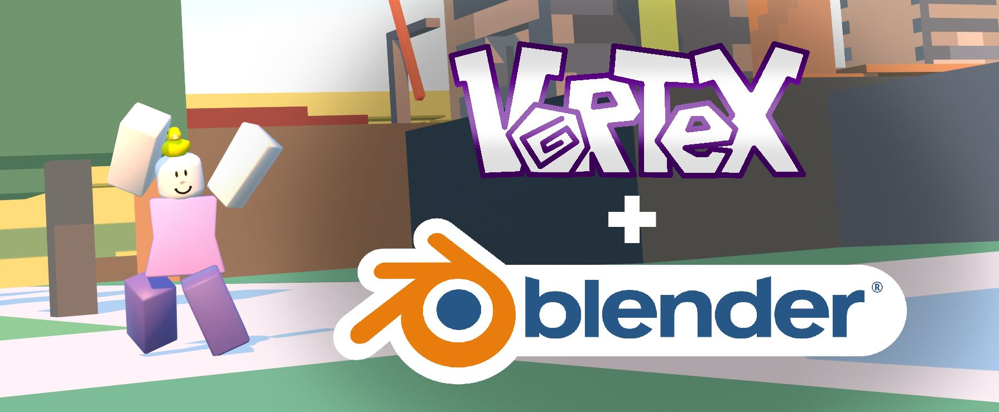
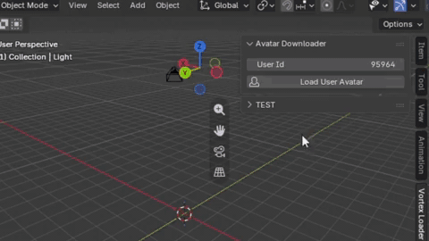
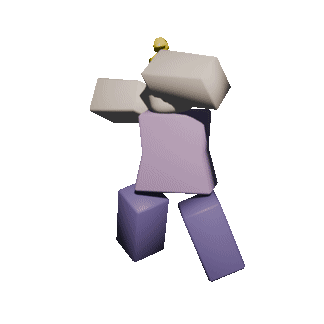

# [Vortex](https://playvortex.io) Blender Addon

A bad, partially vibecoded Vortex user avatar rig downloader. And project Import-Export blender addon.

Targets Blender 5.2+  (Tested only on Windows)

## Supported Features:

- Load any Vortex user avatar from just a User Id.
 - - (It directly downloads textures and meshes from [playvortex.io](https://playvortex.io))

- Import Vortex Json place file.
- Export Vortex Json place file. (It assumes all objects are scaled cubes.)

## Installation:

1. [Download](https://github.com/barbq205/blender-vortex/releases) the addon zip file
2. Import the downloaded .zip file by selecting it from (User) Preferences/Addons/Install from File
3. Use the addon.

## TODO

- Add `.vrtx` project file support.
- Materials ORM textures are set up wrong. I don't know real names of the textures.
- Imported parts UV scale is wrong.
- Import/Exports are incomplete and inacurate.
- Import/Exports are extremely slow.
- The code is rushed shit.
- Clean up the code.
- I don't know how to make blender extensions. Idk how this one works.

## pls contribute smth

